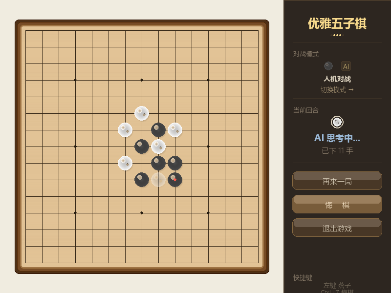
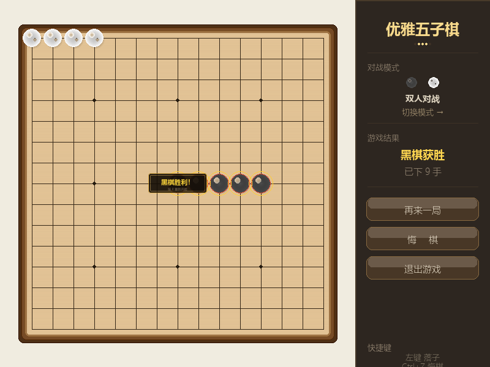
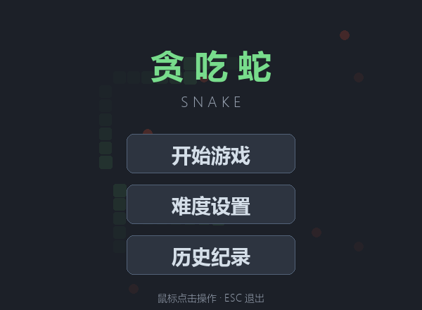

# ai-coursework

《人工智能编程实践》课程作品集：三个用 Python 完成的可以跑起来的小项目，外加一个上线到扣子商店的大模型智能体。

> 这三个程序在课程中以 **AI 辅助编程（vibe coding）** 的方式产出——先用自然语言描述需求让模型生成骨架，
> 再逐条运行、复现问题、定位修 bug，反复迭代到可用。本仓库保留的是最终可运行版本。

| 作品 | 一句话说明 | 技术栈 |
| --- | --- | --- |
| [优雅五子棋](gobang/) | 15×15 棋盘，双人 / 人机对战，AI 靠一张棋型评分表选落点 | Python, Pygame |
| [贪吃蛇](snake/) | 三档难度、随机墙体、敌对生物、道具系统与本地成绩榜 | Python, Pygame, wave |
| [文献解读助手](literature-assistant/) | 已发布到扣子商店的论文解读智能体 | 扣子（Coze）, Prompt 工程 |

## 截图

**五子棋**（左：人机对战进行中；右：黑棋五连获胜）




**贪吃蛇**（左：主菜单；右：对局中，分数 6、速度 8.9）




## 运行

需要 Python 3.10 以上版本。两个游戏都只依赖 pygame，各自是**单文件**，下载下来就能跑。

```bash
python -m pip install -r requirements.txt

python gobang/gobang.py      # 五子棋
python snake/tanchishe.py    # 贪吃蛇
```

## 目录结构

```
gobang/
  gobang.py                单文件约 1500 行：棋盘逻辑 + AI + 渲染
  README.md                玩法、AI 评分算法说明
  screenshot*.png
snake/
  tanchishe.py             单文件约 1300 行：游戏逻辑 + 渲染 + 音效 + 菜单
  README.md                玩法、难度参数、成绩记录说明
  screenshot*.png
literature-assistant/
  README.md                智能体链接、Prompt 设计思路与检查清单
requirements.txt
```

## 几个自己比较满意的点

- **五子棋的 AI 没有用博弈树搜索**，而是一张显式的棋型评分表：按「连子数 + 是否开口」把棋型分成 10 档，
  再以 `进攻分 + 防守分 × 1.1` 综合打分选点。分值级差约 10 倍，保证高阶棋型能覆盖低阶棋型。
  在 15×15 棋盘上是毫秒级响应。细节见 [gobang/README.md](gobang/README.md)。
- **贪吃蛇把难度抽成了参数**：基础速度、速度上限、每分增速、墙体数、敌人数都由难度预设决定，
  逻辑帧与渲染帧分离（逻辑按难度变速、渲染固定 60 FPS）。
- **音效不依赖任何素材文件**：用 `array` 和 `wave` 实时合成扫频音，无音频设备时自动静默降级，程序照常运行。
- **两个程序都有容错**：没有音频设备、成绩文件损坏、鼠标点在棋盘外等边界情况都不会崩。

## 已知不足 / 下一步

- 五子棋的 AI 是贪心评分，没有前瞻搜索，遇到「双活三」这类复合威胁会顾此失彼；
  想提升可以考虑在评分之上加一层浅层搜索。
- 贪吃蛇的敌对生物是随机游走，不会追着蛇跑，难度主要来自速度和障碍密度。
- 两个程序都还没有自动化测试，目前靠手动改参数、反复运行来验证。

## 说明

本项目是课程作业，不是生产级代码。仓库里的截图由脚本调用 pygame 的 dummy 视频驱动无头渲染生成，
不是屏幕截图。
