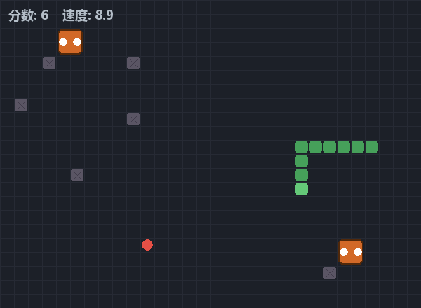

# 贪吃蛇（Snake）

带难度分级、随机墙体、敌对生物和道具的贪吃蛇，单文件约 1300 行。




## 运行

```bash
python -m pip install pygame
python tanchishe.py
```

## 玩法

| 操作 | 说明 |
| --- | --- |
| 方向键 | 控制方向；支持预输入，快速连按不会丢指令 |
| 主菜单 | 开始游戏 / 难度设置 / 历史纪录 |
| ESC | 退出 |

### 场上的东西

- **灰色方块**：随机生成的墙体，撞上算撞墙。
- **橙色怪物**：会缓慢移动（每 3 帧动一次，比蛇慢），撞上会扣分。
- **红色食物**：常规食物，吃到一个加分并加速。
- **巨大食物**（每 12 秒生成、存在 6 秒）：一次加 5 分，但位置随机、容易撞墙或怪物。
- **光盾**（每 30 秒生成、存在 6 秒）：吃到后 5 秒内免疫一次撞击。

## 难度参数

三档难度不改代码，只换一组参数：

| 难度 | 基础速度 | 速度上限 | 每分增速 | 墙体 | 怪物 |
| --- | --- | --- | --- | --- | --- |
| 简单 | 6 | 14 | 0.12 | 3 处 | 1 只 |
| 中等 | 8 | 20 | 0.15 | 6 处 | 2 只 |
| 困难 | 11 | 26 | 0.20 | 10 处 | 4 只 |

这些参数集中定义在文件顶部的 `DIFFICULTY_PRESETS` 里，测试不同难度只需要改这一个列表。

## 逻辑帧与渲染帧分离

渲染固定 60 FPS，蛇的移动速度由难度和当前得分决定，两者用累积计时器（`dt`）解耦：

```python
self.move_timer += dt
if self.move_timer >= 1.0 / self.get_move_interval():
    self.move_timer = 0.0
    self._step()   # 真正走一格
```

这样蛇变快时画面依然平滑，不会因为逻辑帧变快而掉帧。

## 成绩记录

每一局结束（分数大于 0）会把成绩写进脚本同目录下的 `snake_history.json`，**按难度分组**保存，
每个难度各留前 10 条：

```json
{
  "1": [
    { "score": 12, "date": "2026-08-08 12:28" },
    { "score": 6,  "date": "2026-08-08 12:15" }
  ],
  "2": [ ... ]
}
```

分难度存的意义在于：不同难度的分数不可比，混在一张榜上没法看。
写入失败（文件只读、磁盘满）会被 `except OSError` 吞掉，不影响游戏继续运行。

## 音效

不依赖任何音频素材文件，用标准库 `array` + `wave` 现场合成一段扫频音：

| 事件 | 音色 |
| --- | --- |
| 吃到食物 | 900 Hz → 1500 Hz 上扬「叮」，0.16 秒 |
| 撞击扣分 | 260 Hz → 180 Hz 低沉「嘟」，0.30 秒 |

采样率 22050 Hz、峰值振幅 8000。如果机器没有音频设备，`pygame.mixer.init()` 会抛异常并被捕获，
程序自动静默降级（`self.enabled = False`），继续可玩——所以在没有声卡的机器上也不会启动失败。

## 代码结构

| 类 / 函数 | 职责 |
| --- | --- |
| `SnakeGame` | 游戏逻辑：移动、碰撞、道具生成、难度参数 |
| `SnakeRenderer` | 全部绘制：网格、墙体、怪物、蛇、道具、分数、结束画面 |
| `SoundManager` | 程序化合成与播放音效，无设备时降级 |
| `MainMenu` / `MenuBackground` | 主菜单与背景动画 |
| `load_history` / `add_history` | 成绩读写 |

## 已知不足

- 怪物是随机游走，不会追蛇，难度主要来自速度和障碍密度；
  想更有挑战性可以给怪物加一个朝蛇头方向的寻路。
- 只有一根蛇，没有考虑多蛇对战。
- 没有自动化测试，改参数后靠手动多跑几局验证。
